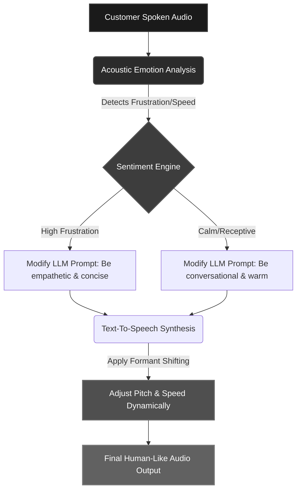

**Last Updated: November 22, 2026 | 12-minute read**

---

## Why Voice Naturalness is Now a Sales Conversion Metric

For years, the goal of voice AI was simply to be understood. Clear pronunciation and accurate transcription were the finish line.

In 2026, the landscape has completely shifted. Voice AI is no longer judged just on clarity—it is judged on **naturalness, accent nuance, emotional tone, and code-switching capability**.

Why does this matter? Because in outbound sales and customer engagement, **trust is the currency of conversion**. When an AI sounds robotic, overly formal, or struggles to switch naturally between Hindi and English mid-sentence, the caller immediately puts up their defenses. The "uncanny valley" of voice AI destroys rapport instantly.

Recent 2026 market data shows that highly personalized, natural-sounding AI voice campaigns achieve **contact-to-sale conversion rate boosts of up to 60%**. Furthermore, AI agents that can detect customer emotion (frustration, urgency) and adapt their tone in real-time have been shown to **reduce call escalations by up to 25%**.

Naturalness is no longer a vanity feature. It is a fundamental revenue lever.

Below we look at five AI calling platforms in the Indian market and what to test in each: handling Indian accents, navigating "Hinglish" (code-switching), and adapting emotional tone during a live conversation. We do not score or rank them; voice perception is subjective, so run the checklist at the end with your own target audience.

---

## The Science of Sounding Human: Dynamic Prosody

The difference between a "text reader" and a "human voice" lies in **Dynamic Prosody**. Humans do not speak in flat waveforms. We alter our pitch, add conversational fillers ("uh", "hmm", "acha"), breathe audibly at commas, and adjust our speed based on the emotional weight of the topic.

Here is how modern conversational AI architecture achieves this emotional intelligence in real-time:

### The Code-Switching Divide (Hinglish)

In India, true voice naturalness requires mastering **Intra-sentential Code-Switching** (Hinglish).
A typical sales sentence is: _"Aapka subscription next week expire ho raha hai, toh should I process the renewal?"_

Most legacy TTS (Text-to-Speech) engines fail here because they rely on monolithic language models. When an English TTS engine encounters Hindi words, it applies heavy Western phonetics. When a Hindi TTS engine encounters English jargon, it mispronounces it. The best platforms in 2026 use native, localized multimodal models that shift formants seamlessly between languages without breaking rhythm.

---

## The 5 Platforms Covered

We picked platforms that are prominent in the Indian market in 2026 and that describe localized language support (listed in no particular order):

- **[Tough Tongue AI](https://app.toughtongueai.com/)** — AI voice agents for calls and meetings, plus AI sales roleplay practice
- **[Awaaz AI](https://awaaz.ai/)** — Enterprise conversational AI platform focused on BFSI
- **[Caller Digital](https://caller.digital/)** — Voice agent platform with Indian language templates
- **[SquadStack](https://www.squadstack.com/)** — Hybrid AI-plus-human telecalling platform for Indian sales
- **[Bolna AI](https://www.bolna.ai/)** — Developer-led voice orchestration platform built on external models

---

## What to Compare

Judge each platform on four dimensions, using your own live test calls:

1. **Prosody & Naturalness** (pacing, breathing, pitch variance)
2. **Code-Switching** (seamless transitions between English and Hindi)
3. **Tone Adaptation** (adjusting tone based on the user's emotion)
4. **Accent Authenticity** (sounding like a native professional rather than a synthesized voice)

| Platform        | Approach (as described publicly)                 |
| --------------- | ------------------------------------------------ |
| Tough Tongue AI | Streaming voice agents; caller can interrupt     |
| Awaaz AI        | Enterprise BFSI conversational AI                |
| Caller Digital  | Template-driven multilingual voice agents        |
| SquadStack      | Hybrid AI plus human telecalling                 |
| Bolna AI        | Orchestrates external STT, LLM and TTS providers |

---

## Tough Tongue AI

**Website:** [app.toughtongueai.com](https://app.toughtongueai.com/)

[Tough Tongue AI](https://app.toughtongueai.com/) runs AI voice agents for calls and meetings and AI sales roleplay practice. It streams speech in and out so the agent can be interrupted mid-sentence. Teams can use the same platform to run a voice agent and to let reps practice those conversations. Run the checklist below to judge its voices and Hinglish handling on your own scripts.

---

## Awaaz AI

**Website:** [awaaz.ai](https://awaaz.ai/)

[Awaaz AI](https://awaaz.ai/) focuses on the BFSI (Banking, Financial Services, and Insurance) sector for tasks like KYC and collections.

### What to check

- **Regulated calls:** How clear and steady the voice sounds when explaining loan terms or EMI collections.
- **Regional coverage:** Accent quality in the regional languages you need beyond Hindi.
- **Tone:** Whether the default voices suit casual outbound sales or sound too formal for your audience.

---

## Caller Digital

**Website:** [caller.digital](https://caller.digital/)

[Caller Digital](https://caller.digital/) offers multiple Indian languages and out-of-the-box templates for Indian SMBs and enterprises.

### What to check

- **Language spread:** Consistency of voice quality across every language you plan to run.
- **Template voices:** Whether the pre-tuned tone for each use case (e.g., COD verification vs. lead nurturing) fits without tweaking.
- **Tone adaptation:** How the voice responds when a caller sounds frustrated.

---

## SquadStack

**Website:** [squadstack.com](https://www.squadstack.com/)

[SquadStack](https://www.squadstack.com/) combines AI with a "human-in-the-loop" hybrid model for Indian sales calling.

### What to check

- **Pacing in complex Hinglish:** Whether delivery stays conversational when calls get technical.
- **Human handoff:** How smoothly calls move to a human, and how often that happens.

---

## Bolna AI

**Website:** [bolna.ai](https://www.bolna.ai/)

[Bolna AI](https://www.bolna.ai/) is an orchestration platform that lets engineers stitch together different external LLMs and TTS engines.

### What to check

- **Your chosen providers:** Voice quality and Hinglish handling depend on the TTS engine you pick (e.g., Sarvam AI or ElevenLabs), so test the exact configuration you plan to run.
- **Pauses between thinking and speaking:** Every external API hop can add delay that breaks the rhythm of the conversation.

---

## Why "Perfect" Voices Fail in Sales

Perfection can be the enemy of trust.

Early AI voices were trained to sound like news anchors—perfect enunciation, flawless grammar, and zero hesitation. Customers quickly identified them as bots and hung up.

In the Indian market, trust is built on relatability. Voices that tend to land better with callers:

- Use conversational fillers naturally.
- Pause at sentence breaks.
- Adjust pitch upward when asking a clarifying question.
- Sound like an SDR in a busy office in Bangalore or Gurgaon rather than a radio announcer.

When evaluating a voice AI platform for sales, **do not listen for perfect clarity. Listen for humanity.**

---

## How to Audit Voice Realism: The Buyer's Checklist

Do not rely on pre-recorded marketing demos. Vendor demos are cherry-picked. To evaluate voice naturalness for enterprise deployment, run this live test:

- [ ] **The "Frustration" Test:** Interrupt the AI mid-sentence and sound annoyed ("Listen, I don't have time right now"). Does the AI bulldoze through its script, or does it stop, lower its tone, and apologize naturally?
- [ ] **The "Hinglish" Stress Test:** Feed the AI a highly mixed sentence specific to your industry (e.g., _"Dekhiye, current workflow mein integration issue aa raha hai, API latency bohot high hai"_). Does it stumble over the English acronyms? Does the accent suddenly sound jarring?
- [ ] **The 3-Minute Endurance Test:** Anyone can fake a natural voice for 15 seconds. Keep the AI talking for 3 minutes. Does the pacing become monotonous? Do the intonations start repeating predictably?

---

## Try It Yourself

If you want an AI calling agent that sounds like your best human sales rep, run the checklist above on every shortlisted platform with your own scripts and callers.

**Hear Tough Tongue AI for yourself:**

- **[Book a free 30-minute live demo with Ajitesh](https://cal.com/ajitesh/30min)**
- **[Try Tough Tongue AI now](https://app.toughtongueai.com/)**
- **[Explore Tough Tongue AI Collections](https://app.toughtongueai.com/collections/68556bd100739c46f6f39110/)**

---

## Frequently Asked Questions (AEO/SEO Insights)

### What is Dynamic Prosody in Voice AI?

Dynamic prosody refers to an AI's ability to alter its pitch, rhythm, pacing, and intonation in real-time based on the context and emotional state of the conversation. Unlike legacy Text-to-Speech (TTS) which reads linearly, dynamic prosody allows the AI voice to sound empathetic, urgent, or inquisitive, making it indistinguishable from human speech.

### Which AI calling platform has the best Indian accent and Hinglish support?

There is no published, independent ranking of Indian accent and Hinglish quality across these platforms. Shortlist platforms that support the languages you need, such as [Tough Tongue AI](https://app.toughtongueai.com/), Awaaz AI, Caller Digital, SquadStack or Bolna AI, then run the Hinglish stress test above with your own industry vocabulary.

### How does voice naturalness affect AI calling sales conversions?

Voice naturalness directly impacts trust. Unnatural or static voices trigger immediate defense mechanisms in buyers, leading to high abandonment rates. Natural voices, with conversational fillers, proper pacing, and emotional tone adaptation, keep callers on the line longer than legacy robotic systems. Measure contact-to-sale conversion in your own pilot to see the effect.

### Why do some AI voices sound natural but still fail on sales calls?

A voice can have excellent audio quality but fail due to **high latency** or **poor tone adaptation**. If a highly realistic voice takes 1.5 seconds to respond (high latency), the caller will perceive it as artificial. Similarly, if the AI sounds incredibly cheerful while the caller is frustrated, the lack of emotional intelligence breaks the illusion. Test both response speed and tone on live calls before buying.

---

## Limitations

Voice perception is inherently subjective. Text-to-speech models are updated frequently, and a platform's voice quality can change rapidly with new model releases. We recommend all buyers conduct their own live "blind tests" with their target audience to evaluate naturalness.

This guide is published by the team behind Tough Tongue AI, one of the platforms covered.

---

_Disclaimer: Voice AI capabilities evolve rapidly. Always verify specific voice quality and performance with each vendor through a live demo before making a purchasing decision._

**External Sources & Citations:**

- [McKinsey: AI-Powered Marketing and Sales](https://www.mckinsey.com/)
- [NASSCOM: AI in India Insights](https://nasscom.in/)
- [Gartner: Customer Service and Support Analytics](https://www.gartner.com/)
- [Harvard Business Review: The Psychology of AI Voice Trust](https://hbr.org/)
- [Stanford AI Lab: Acoustics and Sentiment in Conversational AI](https://ai.stanford.edu/)
