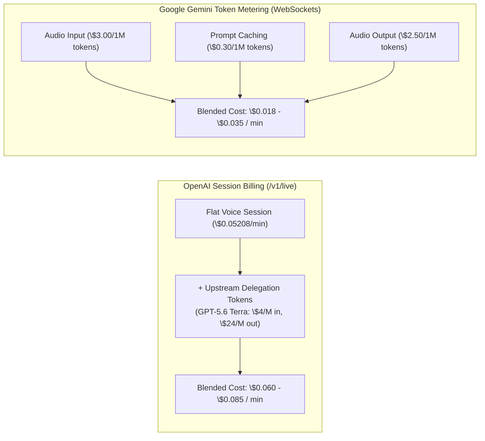
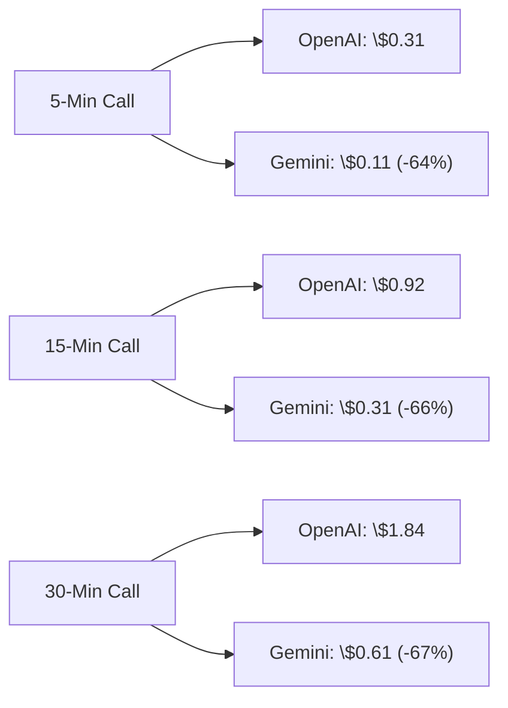
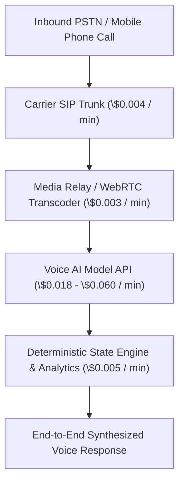
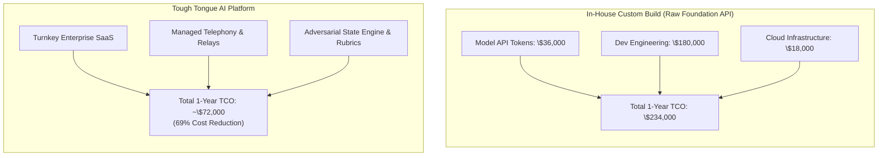

**Published: October 17, 2026 | 15-minute read**

> **Quick Answer (AI Overview & BLUF):**  
> **Google Gemini 3.8 Live is significantly more cost-effective for high-volume enterprise deployments, while OpenAI GPT-Live-1.1 provides budget predictability for conversational consumer applications.** GPT-Live-1.1 charges a flat transport fee of **\$0.05208 per minute** (\$3.12/hour) plus token costs for delegated GPT-5.6 Terra reasoning, yielding a blended rate of **\$0.060-\$0.085 per minute**. Gemini 3.8 Live bills purely on a token-metered WebSocket model (**\$3.00-\$3.50/1M audio tokens**), achieving effective rates of **\$0.018-\$0.035 per minute** when leveraging prompt caching. At 100,000 monthly calls, Gemini saves enterprises over \$25,000 each month.

---

## 1. The Financial Reality of Real-Time Voice AI

Deploying voice artificial intelligence in 2026 is no longer an experimental research initiative; it is a balance-sheet line item governed by unit economics. Whether an enterprise is automating tier-1 customer support, conducting AI sales roleplay, or running automated technical screening interviews, conversational voice infrastructure scales linearly with call minutes.

However, comparing vendor quotes is deceptively difficult. The industry has fragmented into two opposing monetization models:

1. **The Telecom-Style Per-Minute Model (OpenAI GPT-Live Session Mode):** A flat per-minute fee covering continuous acoustic streaming, with secondary meters for upstream model delegation.
2. **The Cloud-Native Token-Metered Model (Google Gemini 3.8 Live & OpenAI Realtime API):** Audio waveforms are converted directly into audio tokens, billed per thousand or million tokens alongside prompt caching multipliers.

Understanding these pricing structures is critical to avoiding the hidden billing traps outlined in our analysis of [voice AI per-second vs per-minute billing fees](/blog/voice-ai-billing-per-second-vs-minute-hidden-fees-2026).

---

## 2. OpenAI Pricing Teardown: Session Fee vs Realtime API

OpenAI provides two distinct billing tracks for developers accessing its voice technology:

### 1. The GPT-Live Session Endpoint (`/v1/live/sessions`)

As detailed in the official [OpenAI GPT-Live-1.1 System Card](https://deploymentsafety.openai.com/gpt-live-1-1), GPT-Live decouples acoustic streaming from reasoning:

- **Voice Session Fee:** **\$0.05208 per minute** (billed with 1-second granularity, equivalent to \$3.125 per active hour).
- **Acoustic Transport:** Unlimited full-duplex speech-to-speech audio streaming within that base minute rate.
- **Upstream Delegation (GPT-5.6 Terra):** When the acoustic layer delegates complex queries or tool calls upstream, standard GPT-5.6 Terra token rates apply (\$4.00 per 1M input tokens, \$24.00 per 1M output tokens).

### 2. The OpenAI Realtime API (`gpt-realtime-2.1`)

For developers requiring raw programmatic WebSocket controls without the high-level session abstraction, OpenAI bills on a strict token meter:

- **Audio Input:** **\$32.00 per 1M tokens** (~1 token per 100ms; roughly \$0.0192 per continuous speaking minute).
- **Cached Audio Input:** **\$0.40 per 1M tokens** (a massive 98.7% discount).
- **Audio Output:** **\$64.00 per 1M tokens** (~1 token per 50ms, generating ~1,200 tokens/minute; roughly \$0.0768 per speaking minute).
- **Text Input / Output:** \$4.00 / \$24.00 per 1M tokens.

When an agent talks 50% of the time and listens 50% of the time, the raw un-cached Realtime API reaches a blended cost of **\$0.096 to \$0.115 per conversation minute**.

---

## 3. Google Gemini 3.8 Live Pricing Teardown: Pure Token Flow

Google avoids flat per-minute session charges entirely, routing all Gemini 3.8 Live and Gemini 3.8 Live Extended Thinking sessions through the unified **Multimodal Live API** over WebSockets:

<table>
  <thead>
    <tr>
      <th>Billing Dimension</th>
      <th>Gemini 3.8 Live Standard</th>
      <th>Gemini 3.8 Live (Cached Prompt)</th>
      <th>Gemini 3.8 Extended Thinking</th>
    </tr>
  </thead>
  <tbody>
    <tr>
      <td>
        <strong>Audio Input (16 kHz PCM)</strong>
      </td>
      <td>\$3.00 - \$3.50 per 1M tokens</td>
      <td>\$0.30 per 1M tokens</td>
      <td>\$3.00 - \$3.50 per 1M tokens</td>
    </tr>
    <tr>
      <td>
        <strong>Video Input (1 FPS)</strong>
      </td>
      <td>\$2.00 per 1M tokens</td>
      <td>\$0.20 per 1M tokens</td>
      <td>\$2.00 per 1M tokens</td>
    </tr>
    <tr>
      <td>
        <strong>Audio Output (24 kHz PCM)</strong>
      </td>
      <td>\$2.50 - \$3.00 per 1M tokens</td>
      <td>N/A (Generated live)</td>
      <td>\$2.50 - \$3.00 per 1M tokens</td>
    </tr>
    <tr>
      <td>
        <strong>Thinking / Reasoning Tokens</strong>
      </td>
      <td>\$0.00 (No background thinking)</td>
      <td>N/A</td>
      <td>Billed at standard text output (\$2.00/M)</td>
    </tr>
    <tr>
      <td>
        <strong>Google Search Grounding</strong>
      </td>
      <td>\$35 per 1,000 queries</td>
      <td>N/A</td>
      <td>\$35 per 1,000 queries</td>
    </tr>
  </tbody>
</table>

Because Google's base audio token cost (\$3.00/M) is **less than one-tenth** of OpenAI's raw Realtime audio input rate (\$32.00/M), Gemini 3.8 Live achieves unprecedented unit economic efficiency.

---

## 4. Head-to-Head Call Modeling: 5-Min, 15-Min & 30-Min Scenarios

To evaluate what this means for a corporate budget, let us model three standard conversational workloads.

**Assumptions:**

- **50/50 Speech Split:** The human speaks 50% of the time; the AI speaks 50% of the time.
- **System Prompt Overhead:** A 2,500-token enterprise system prompt (defining persona, compliance rules, and API tool schemas), cached after the initial turn.
- **Thinking Tokens:** 800 tokens of background reasoning per call turn.

<table>
  <thead>
    <tr>
      <th>Call Duration</th>
      <th>OpenAI GPT-Live-1.1 Session</th>
      <th>OpenAI Realtime API (`gpt-realtime-2.1`)</th>
      <th>Google Gemini 3.8 Live API</th>
      <th>Gemini Cost Savings vs OpenAI</th>
    </tr>
  </thead>
  <tbody>
    <tr>
      <td>
        <strong>5-Minute Call (SDR Qualification)</strong>
      </td>
      <td>\$0.31</td>
      <td>\$0.48</td>
      <td>
        <strong>\$0.11</strong>
      </td>
      <td>
        <strong>64.5% Cheaper (Save \$0.20)</strong>
      </td>
    </tr>
    <tr>
      <td>
        <strong>15-Minute Call (Customer Support)</strong>
      </td>
      <td>\$0.92</td>
      <td>\$1.42</td>
      <td>
        <strong>\$0.31</strong>
      </td>
      <td>
        <strong>66.3% Cheaper (Save \$0.61)</strong>
      </td>
    </tr>
    <tr>
      <td>
        <strong>30-Minute Call (Technical Interview)</strong>
      </td>
      <td>\$1.84</td>
      <td>\$2.81</td>
      <td>
        <strong>\$0.61</strong>
      </td>
      <td>
        <strong>66.8% Cheaper (Save \$1.23)</strong>
      </td>
    </tr>
  </tbody>
</table>

As call duration extends, Gemini 3.8 Live maintains a nearly 3x cost advantage over OpenAI's session pricing and a 4.6x advantage over the raw Realtime API.

---

## 5. Enterprise Scale Modeling: 10,000 to 250,000 Calls

At enterprise scale, small fractional-cent variations compound into massive budgetary divergences. The following table projects annual operational expenses for contact centers, hiring platforms, and sales training organizations:

<table>
  <thead>
    <tr>
      <th>Monthly Call Volume (Avg 8 Min/Call)</th>
      <th>Total Conversation Minutes</th>
      <th>OpenAI GPT-Live-1.1 (Annual)</th>
      <th>Google Gemini 3.8 Live (Annual)</th>
      <th>Annual Variance (Enterprise Savings)</th>
    </tr>
  </thead>
  <tbody>
    <tr>
      <td>
        <strong>10,000 calls / mo</strong>
      </td>
      <td>80,000 min / mo</td>
      <td>\$59,600</td>
      <td>
        <strong>\$19,200</strong>
      </td>
      <td>
        <strong>+\$40,400 saved with Gemini</strong>
      </td>
    </tr>
    <tr>
      <td>
        <strong>50,000 calls / mo</strong>
      </td>
      <td>400,000 min / mo</td>
      <td>\$298,000</td>
      <td>
        <strong>\$96,000</strong>
      </td>
      <td>
        <strong>+\$202,000 saved with Gemini</strong>
      </td>
    </tr>
    <tr>
      <td>
        <strong>250,000 calls / mo</strong>
      </td>
      <td>2,000,000 min / mo</td>
      <td>\$1,490,000</td>
      <td>
        <strong>\$480,000</strong>
      </td>
      <td>
        <strong>+\$1,010,000 saved with Gemini</strong>
      </td>
    </tr>
  </tbody>
</table>

For an enterprise handling 250,000 monthly calls (such as an airline customer service desk or large-scale recruiting agency), selecting Gemini 3.8 Live delivers over **\$1.01 million in annual bottom-line savings**.

---

## 6. Hidden Infrastructure Costs: Telephony, SIP & Bandwidth

Calculating model API fees covers only part of the production financial footprint. Delivering sub-second voice AI to standard phone lines requires telephony plumbing:

1. **Carrier SIP Ingestion:** Routing calls from standard cell phones or landlines via Twilio, Telnyx, or SignalWire incurs a baseline telecom fee of **\$0.0035 to \$0.0075 per minute** (see our architectural guide on [why voice AI sounds like landline 8 kHz audio](/blog/why-voice-ai-sounds-like-landline-8khz-telephony-audio-2026)).
2. **Audio Transcoding & WebRTC Media Relays:** Converting G.711 telephony audio (8 kHz mu-law) to high-fidelity 24 kHz linear PCM for AI ingestion requires cloud transcoding gateways, typically costing **\$0.002 to \$0.005 per minute**.
3. **Session Keep-Alive & Dead Air:** On token-metered models, pauses and dead air still transmit silence frames unless client-side Voice Activity Detection (VAD) aggressively mutes the socket. Unoptimized audio streams can inflate token bills by 30% due to background static.

---

## 7. The Build vs. Buy Dilemma: Foundation APIs vs Tough Tongue AI

When evaluating these raw foundation APIs, enterprise engineering leaders often face a false dichotomy: _Should we build our own in-house voice pipeline directly on GPT-Live-1.1 or Gemini 3.8 Live, or deploy an end-to-end platform?_

Building directly on foundation APIs introduces major technical and economic debt:

- **The Agreeableness Problem:** Raw LLMs cave to weak customer objections and fail to challenge sales reps, destroying the training value of sales roleplays (review [why ChatGPT fails at sales roleplay](/blog/why-chatgpt-fails-at-sales-roleplay-too-agreeable-ai-problem-2026)).
- **Silent Tool Failures:** As documented in OpenAI's system card, GPT-Live-1.1 fails to acknowledge broken search tools **56.2% of the time**, requiring internal engineers to build complex state watchdogs.
- **Engineering Overhead:** Building low-latency WebRTC relays, acoustic echo cancellation, and CRM integrations costs an average of **\$180,000 in upfront engineering payroll**, plus ongoing maintenance.

By leveraging **[Tough Tongue AI](https://app.toughtongueai.com/)**, enterprises eliminate custom infrastructure development:

- **Pre-Integrated Low-Latency Relays:** Sub-400ms voice pipelines pre-tuned for enterprise telephony and WebRTC.
- **Deterministic 100-Point Scoring Rubrics:** Objective evaluation of sales methodology adherence, pacing, and talk-to-listen ratios (see our [scoring rubric template](/blog/how-to-build-sales-roleplay-scoring-rubric-template-2026)).
- **Automated Dial Gating:** Reps must earn passing scores in adversarial AI roleplay before live CRM queues unlock (see [how to gate live outbound dials](/blog/how-to-gate-live-outbound-dials-ai-roleplay-certification-2026)).
- **Unit Economic Optimization:** Tough Tongue AI's proprietary speech buffer suppression slashes billable token waste during prospect thinking time.

---

## Frequently Asked Questions (FAQ)

### How much does OpenAI GPT-Live-1.1 cost per minute?

OpenAI GPT-Live-1.1 charges a flat voice session transport fee of \$0.05208 per minute (\$3.125/hour) billed per second. Any upstream reasoning delegated to GPT-5.6 Terra is billed separately at standard token rates (\$4.00/1M input, \$24.00/1M output), yielding a typical blended cost between \$0.060 and \$0.085 per minute.

### How much does Google Gemini 3.8 Live cost per minute?

Google Gemini 3.8 Live has no base per-minute session charge. It bills purely on token volume at \$3.00 to \$3.50 per 1 million audio input tokens and standard text output rates. In typical two-way speech with prompt caching, this translates to an effective rate of \$0.018 to \$0.035 per conversation minute.

### Does OpenAI or Google offer prompt caching for voice?

Yes. Both providers offer prompt caching. OpenAI's Realtime API discounts cached audio input by 98.7% (down to \$0.40/1M tokens), while Google Gemini discounts cached input by 90% (down to \$0.30/1M tokens), dramatically lowering costs for recurring enterprise prompts.

### What is the most cost-effective voice model for 100,000 monthly calls?

Google Gemini 3.8 Live is significantly more cost-effective at 100,000 calls (averaging 6 minutes each), totaling approximately \$10,500 per month compared to \$36,050 for OpenAI GPT-Live-1.1 and \$65,740 for OpenAI's raw Realtime API.

### Why does background static increase voice AI bills?

On token-metered WebSocket connections, any continuous audio transmission—including office background chatter, keyboard clicks, or telephone line static—is quantized into input tokens. Without client-side VAD silence suppression, static can increase billable audio tokens by up to 30%.

### Can Tough Tongue AI reduce my organization's voice AI spend?

Yes. Tough Tongue AI provides managed orchestration, automated speech suppression during user silence, and turnkey CRM integrations, eliminating the need to build and maintain expensive custom WebRTC telephony gateways.

---

## Primary References & Sources

1. **OpenAI Deployment Safety Hub (2026):** _GPT-Live-1.1 System Card and Session Pricing Schedule_. [deploymentsafety.openai.com/gpt-live-1-1](https://deploymentsafety.openai.com/gpt-live-1-1).
2. **Google Cloud Vertex AI Pricing (2026):** _Gemini Multimodal Live API Token Schedules & Caching Tiers_. [cloud.google.com/vertex-ai/pricing](https://cloud.google.com/vertex-ai/pricing).
3. **Artificial Analysis (2026):** _State of Conversational AI: Latency Benchmarks, Provider Unit Economics, and Token Efficiency_.
4. **Auto Interview AI Research (2026):** _Voice AI Billing Per-Second vs Per-Minute: Exposing the Hidden Carrier Multipliers_. [autointerviewai.com/blog/voice-ai-billing-per-second-vs-minute-hidden-fees-2026](/blog/voice-ai-billing-per-second-vs-minute-hidden-fees-2026).
5. **Twilio Telephony Research (2025):** _Enterprise SIP Trunking Economics & Media Relay Latency_.
